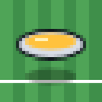
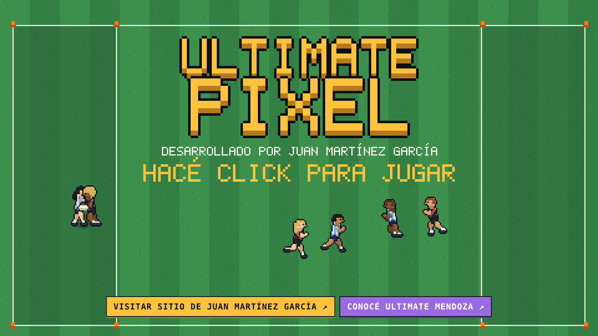
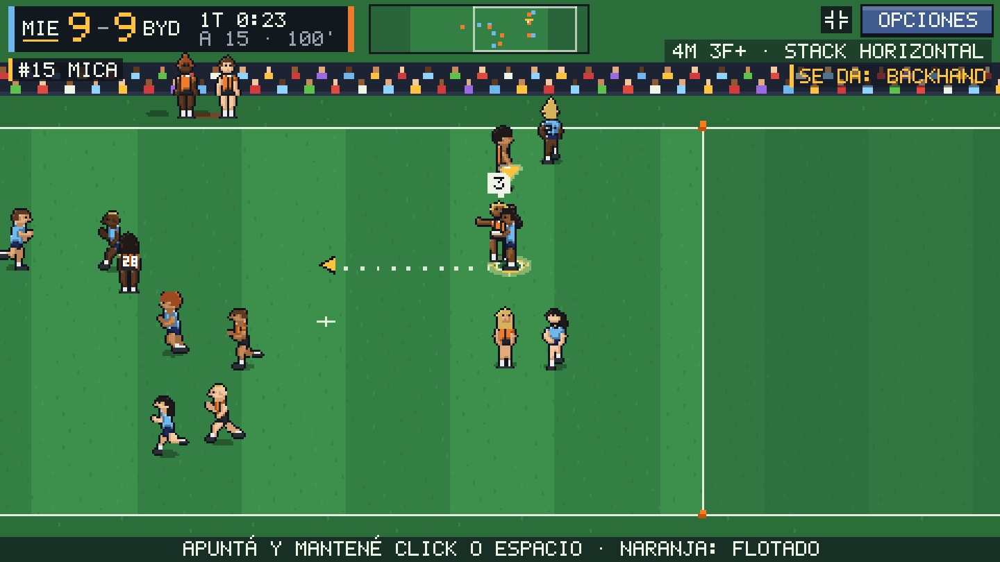
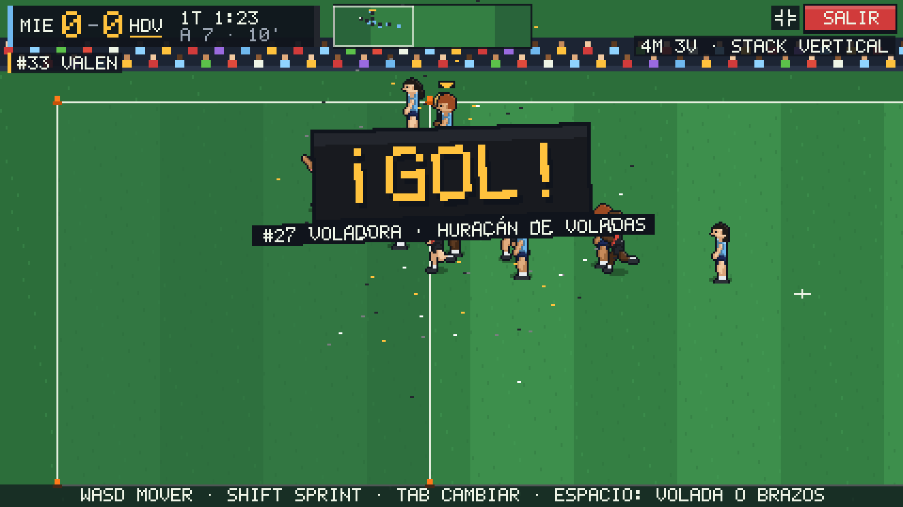
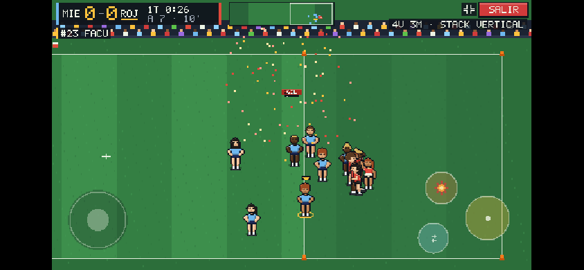
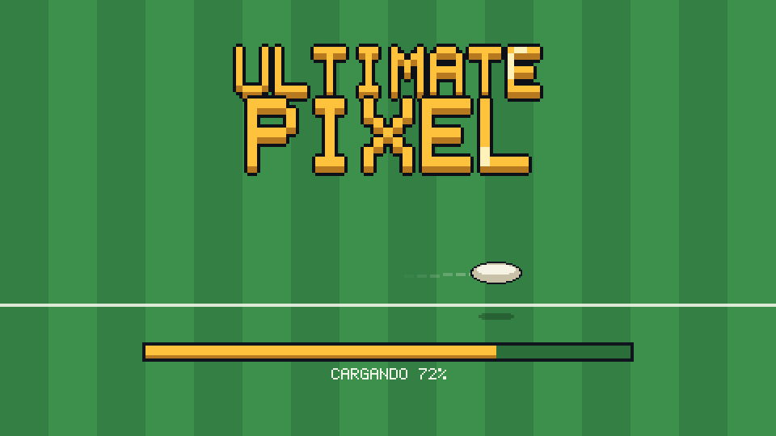
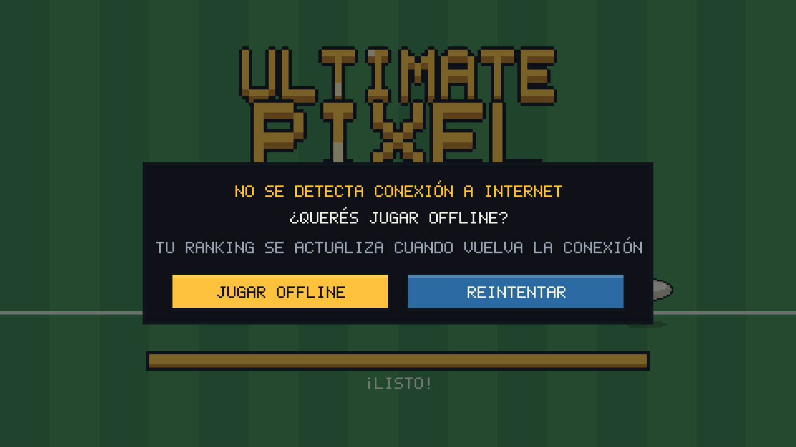

  

<h1 align="center">Ultimate Pixel</h1>

  <b>Ultimate Frisbee en pixel art.</b> Partidos 7 contra 7 con las reglas WFDF 2025-2028, 
  contra la computadora o contra otra persona por internet.

  <a href="https://github.com/juanaustral/ultimate-pixel/releases/latest"><b>Descargar</b></a> ·
  <a href="https://iona.ar/ultimatepixel/"><b>Jugar en el navegador</b></a> ·
  <a href="#cómo-se-juega">Cómo se juega</a>

## Descargar

| Plataforma | Descarga | Notas |
|---|---|---|
| **Android** | [UltimatePixel-Android.apk](https://github.com/juanaustral/ultimate-pixel/releases/latest/download/UltimatePixel-Android.apk) | Teléfonos de 64 bits (arm64), Android 7 o más nuevo. |
| **Windows** | [UltimatePixel-Windows.exe](https://github.com/juanaustral/ultimate-pixel/releases/latest/download/UltimatePixel-Windows.exe) | Windows 10 y 11, 64 bits. |
| **Mac** | [UltimatePixel-Mac.dmg](https://github.com/juanaustral/ultimate-pixel/releases/latest/download/UltimatePixel-Mac.dmg) | Intel y Apple Silicon, macOS 11 o más nuevo. |
| **Linux** | [AppImage](https://github.com/juanaustral/ultimate-pixel/releases/latest/download/UltimatePixel-Linux.AppImage) · [.deb](https://github.com/juanaustral/ultimate-pixel/releases/latest/download/UltimatePixel-Linux.deb) | x86_64. El .deb es para Debian y Ubuntu. |
| **iPhone y cualquier otra** | [iona.ar/ultimatepixel](https://iona.ar/ultimatepixel/) | Se juega en el navegador, sin instalar nada. |

Todas las versiones anteriores están en [Releases](https://github.com/juanaustral/ultimate-pixel/releases).

### Instalar

**Android.** Bajá el APK y abrilo. La primera vez el teléfono pide permiso para instalar apps de esa fuente: aceptalo (Ajustes > Instalar apps desconocidas). El juego abre en horizontal y a pantalla completa.

**Windows.** Bajá el instalador y abrilo. Todavía no está firmado por Microsoft, así que Windows puede mostrar "Windows protegió tu PC": tocá **Más información > Ejecutar de todas formas**. Se instala para tu usuario, sin pedir permisos de administrador.

**Mac.** Abrí el DMG y arrastrá *Ultimate Pixel* a Aplicaciones. Todavía no está firmado por Apple, así que la primera vez macOS lo bloquea: andá a **Ajustes del Sistema > Privacidad y seguridad** y tocá **Abrir igual**. Después abre normal.

**Linux.** AppImage: `chmod +x UltimatePixel-Linux.AppImage` y abrilo. Debian/Ubuntu: `sudo apt install ./UltimatePixel-Linux.deb`.

### Actualizaciones

La app avisa sola cuando sale una versión nueva: aparece **NUEVA ACTUALIZACIÓN** en el menú. En Windows, Mac y Linux (AppImage), con un toque se baja, se instala y se reinicia. En Android abre el APK nuevo y el teléfono ofrece instalarlo encima.

## El juego

- **Ultimate de verdad.** Reglamento WFDF 2025-2028: pull, cuenta de stalling, turnovers, gol en la zona, marca con lado del forehand o del backhand, stack vertical y horizontal.
- **Mixto, 7 contra 7.** Planteles de 8 con rotación por puntos jugados; cada punto juegan 4 y 3, como en la Regla A.
- **Tres dificultades** contra la computadora, y partidos de 5, 10, 15 o 20 minutos o con tiempo reglamentario.
- **Online.** Desafiá a otra persona por internet desde el lobby: cada uno lleva su equipo.
- **Ranking** de partidos ganados por dificultad, con cuenta y contraseña.
- **Armá tu equipo:** nombre, sigla, colores, camiseta y plantel con nombres. También hay equipos para elegir, hechos por otros jugadores.
- **Tutorial** paso a paso: pases, volada, marca y cómo se cuenta el gol.
- **Sin conexión también.** Si no hay internet, la app pregunta si querés jugar OFFLINE: anda todo menos el online, y tus partidos suben al ranking cuando vuelve la conexión.
- **Sonido y música hechos en código:** efectos de partido, público y tres temas chiptune.
- En **español e inglés**; con teclado y mouse o con controles táctiles.

| | |
|---|---|
|  |  |
|  |  |

## Cómo se juega

| Acción | Teclado y mouse | Táctil |
|---|---|---|
| Moverse | W A S D | Palanca izquierda |
| Lanzar | Apuntá con el mouse; mantené clic o Espacio y soltá (más carga, más lejos; la barra naranja es un tiro flotado) | La palanca apunta; mantené ● y soltá |
| Volada (sin el disco, corriendo) o brazos (marcando) | Espacio | ● |
| Sprint corto (se gasta y se recarga) | Shift | Botón de explosión |
| Cambiar de jugador | Tab | ⇄ |
| Pantalla completa | F | Botón de la esquina |

Los botones táctiles se pueden mover a donde te queden cómodos (menú > Controles).

El tutorial del menú lo explica en la cancha.

## Créditos

Hecho por **Juan Martínez García** · [juanmartinezgarcia.com](https://juanmartinezgarcia.com)

Conocé a **Ultimate Mendoza**: [@ultimatefrisbeemza](https://www.instagram.com/ultimatefrisbeemza/)

Todo el arte, la música y los efectos se hicieron para este juego.

---

Este repositorio publica las apps (Android, Windows, Mac y Linux, hechas con [Tauri 2](https://tauri.app)). El código del juego está en un repositorio privado. Cómo se compilan y se publican las versiones: [docs/COMPILAR.md](docs/COMPILAR.md).
